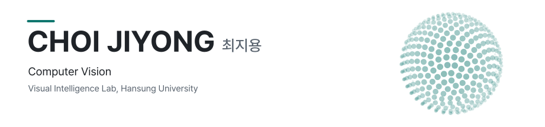

<picture>
  <source media="(prefers-color-scheme: dark)" srcset="assets/header-dark.svg">
  
</picture>

### Now

- **Undergraduate Intern**, Visual Intelligence Lab, Hansung University — 3D object reconstruction

### Awards

- **1st Place** · Synthetic Microstructure Hardness Prediction, DAKER AI Hackathon (DACON, 2026)
- **3rd Place** · Landslide Scar Detection, National Park Satellite Monitoring AI Challenge (AIFactory, 2026)
- **3rd Place** · Dead Conifer Detection, National Park Satellite Monitoring AI Challenge (AIFactory, 2026)
- **3rd Place** (3 / 1,087 teams) · LG Aimers 9th Hackathon (DACON, 2026)
- **Top 7%** · AI Agent Behavior Inference, SW-Centered University Digital Competition (DACON, 2026)
