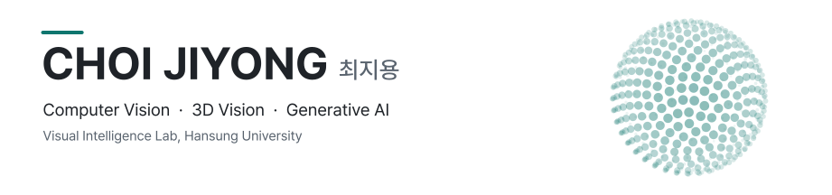

<picture>
  <source media="(prefers-color-scheme: dark)" srcset="assets/banner-dark.svg">
  
</picture>

  <a href="https://yongji04.github.io">Website</a> &nbsp;·&nbsp;
  <a href="https://yongji04.github.io/assets/files/curriculum_vitae.pdf">CV</a> &nbsp;·&nbsp;
  <a href="mailto:jxy040108@gmail.com">jxy040108@gmail.com</a>

### Now

- **Undergraduate Intern**, Visual Intelligence Lab, Hansung University — 3D object reconstruction
- **R&D Intern**, Futurex AI Business Division — bin-picking vision (Nov.–Dec. 2026)

### Awards

- **1st Place** · Synthetic Microstructure Hardness Prediction, DAKER AI Hackathon (DACON, 2026)
- **3rd Place** · Landslide Scar Detection, National Park Satellite Monitoring AI Challenge (AIFactory, 2026)
- **3rd Place** · Dead Conifer Detection, National Park Satellite Monitoring AI Challenge (AIFactory, 2026)
- **3rd Place** (3 / 1,087 teams) · LG Aimers 9th Hackathon (DACON, 2026)
- **Top 7%** · AI Agent Behavior Inference, SW-Centered University Digital Competition (DACON, 2026)
